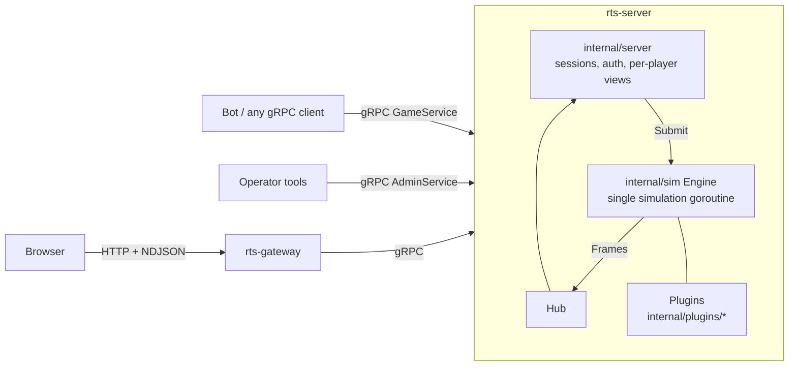

# Mono — a deterministic, server-authoritative RTS engine

Mono is a headless real-time strategy simulation written in Go. One server
process hosts one world. Players connect over a public gRPC API, and so do
AI agents: the server can't tell a human's browser from a bot. Game
mechanics are plugins compiled into the server.

*(The Go module is `github.com/dakotaknutson/unit-strategy-game`; "Mono" is
the project name.)*

## Philosophy

- **One unit type.** There are no unit classes. Every unit starts the same
  and specializes through upgrades (armor, propulsion, sensors, ...). A
  "scout" or a "tank" is just a unit someone upgraded that way.
- **Server-authoritative and deterministic.** The simulation runs in fixed
  ticks on one goroutine, with integer math only, seeded randomness and
  sorted iteration. The same configuration and command log reproduce
  identical state hashes on every run. Clients only *request* changes, and
  the server decides.
- **Players know only what they observe.** Under fog of war, players
  receive their own units plus what their sensors detect, filtered to the
  identification level achieved. Errors don't reveal hidden entities, and
  IDs reveal nothing about counts.
- **Local resources.** There is no global energy pool. Energy lives in
  units, comes from wells and wreckage, and has to be moved physically.
- **Typed automation, not scripts.** Persistent orders and small built-in
  behaviors (mine-and-deliver, guard, follow, supply links) instead of
  server-side player code.

## Status

Milestones 1–7 are implemented: kernel and movement, administration and
the energy economy, unit evolution (attributes, upgrades, cloning,
metadata), combat and salvage, fog of war and sensors, pathfinding,
automation, logistics and scale benchmarks, and complete matches. The last
covers procedural world generation, a lobby, victory conditions, scoring,
results, resets and verifiable replays. Everything is in memory. There is
no persistence, no account system and no runtime plugin loading. See
[what's implemented and what isn't](docs/developer-guide/design-notes.md#not-implemented).

| Area | State |
|---|---|
| Simulation kernel, plugins, determinism, replay from a command log (in process) | Implemented, tested |
| Movement and pathfinding, energy, upgrades, cloning, metadata and batches, combat, salvage, fog of war, automation, logistics | Implemented, tested |
| gRPC `GameService` / `AdminService`, browser gateway, player and admin web clients | Implemented, tested |
| Match lifecycle (lobby, start, pause, finish, reset), world generation, victory conditions, scoring, results, presets, replay export and verification | Implemented, tested |
| Scale: 10k units within a 10 Hz tick budget; 25k with fog of war is over budget | Measured ([performance](docs/developer-guide/design-notes.md#performance-milestone-6)) |
| Persistence (save/load), TLS, accounts, matchmaking, CI, containers | Not implemented |

## Quickstart

Requirements: **Go 1.26.2+** and a browser. Every other tool is pinned in
`tools/go.mod` and runs through `go tool`.

```bash
git clone git@github.com:dakotak/mono-rts-game.git
cd mono-rts-game
make dev
```

| Process | Address | Purpose |
|---|---|---|
| `rts-server` | `127.0.0.1:50051` (gRPC) | Simulation, `GameService`, `AdminService` |
| `rts-gateway` | http://127.0.0.1:8080 | Player web client and player HTTP bridge |
| `rts-gateway` | http://127.0.0.1:8081 | Admin web client and admin HTTP bridge |

Open http://127.0.0.1:8080 in two tabs and join as `red` and `blue`. The
admin client is at http://127.0.0.1:8081 (token `dev-admin`). These
credentials come from [`configs/dev.json`](configs/dev.json) and are for
local development only.

Next: [Quickstart walkthrough](docs/getting-started/quickstart.md).

**Play a real match.** The presets in [`configs/presets`](configs/presets)
generate a map and run a lobby, victory conditions and scoring:

```bash
CONFIG=configs/presets/standard.json make dev    # 2 players, fog of war, last player standing
CONFIG=configs/presets/bot-arena.json make dev   # 4 bots, reproducible seed: go run ./examples/bot -token bot-red
```

See [running matches](docs/operations/matches.md).

## Architecture at a glance



- [`internal/sim`](internal/sim): the kernel. Ticks, commands, entities,
  components, phases, events. It contains no game mechanics.
- [`internal/plugins`](internal/plugins): every mechanic, composed in
  [`game.Plugins()`](internal/game/game.go).
- [`internal/server`](internal/server): the gRPC services.
  [`internal/gateway`](internal/gateway) is the browser bridge.
- [`proto/`](proto): the public API, with one proto package per plugin for
  its commands.

## Documentation

Start at the **[documentation index](docs/README.md)**.

| If you want to... | Read |
|---|---|
| Play | [User guide](docs/user-guide/concepts.md) |
| Run a server | [Installation](docs/getting-started/installation.md), [configuration](docs/getting-started/configuration.md), [operations](docs/operations/deployment.md) |
| Write a bot or client | [API overview](docs/api/overview.md), [bot development](docs/api/bot-development.md) |
| Understand the engine | [Architecture](docs/developer-guide/architecture.md), [simulation](docs/developer-guide/simulation.md), [mechanics rules](docs/developer-guide/mechanics.md) |
| Add a mechanic | [Plugin guide](docs/developer-guide/plugins/overview.md), [plugin tutorial](docs/developer-guide/plugins/getting-started.md), [map generators](docs/developer-guide/plugins/worldgen.md), [victory conditions and scoring](docs/developer-guide/plugins/match-extensions.md) |
| Run matches and replays | [Running matches](docs/operations/matches.md), [replay format](docs/developer-guide/replay.md) |
| Look something up | [Configuration](docs/reference/configuration.md), [commands](docs/reference/commands.md), [events](docs/reference/events.md), [formulas](docs/reference/formulas.md) |

## Development

```bash
make test       # all tests (including examples/)
make race       # all tests with the race detector
make lint       # gofmt check, go vet, staticcheck, buf lint
make generate   # regenerate gen/ from proto/
make bench      # per-tick kernel benchmark
make scale      # scale scenarios: 1k-25k units x 7 workloads
make sim        # headless harness: 5000 units x 2000 ticks
bin/rts-server -check -config configs/presets/standard.json   # validate a configuration
bin/rts-replay verify replay.json                             # reproduce an exported match
make build      # binaries in bin/
```

See [contributing](docs/developer-guide/contributing.md) and
[testing](docs/developer-guide/testing.md).

## License

GNU Affero General Public License v3.0. See [LICENSE](LICENSE).
