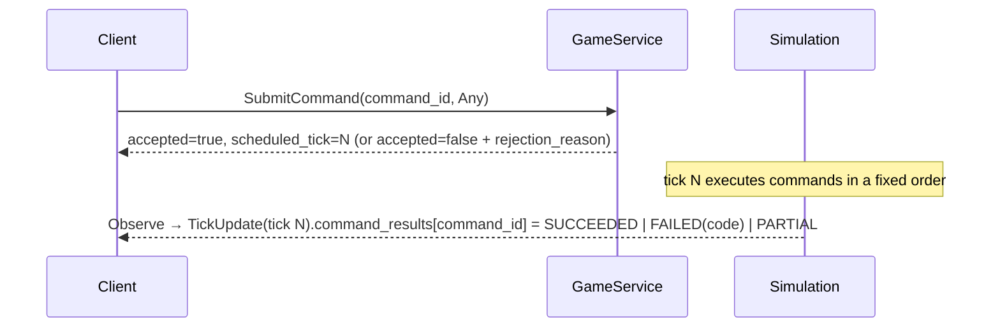

# API overview

Mono's public API is gRPC, defined in [`proto/`](../../proto):

| Service | Proto | For | Auth |
|---|---|---|---|
| `rts.v1.GameService` | [`game.proto`](../../proto/rts/v1/game.proto) | Players: humans' clients and bots alike | Join token → session token |
| `rts.v1.AdminService` | [`admin.proto`](../../proto/rts/v1/admin.proto) | Operators and tools | Static admin token |

Shared messages are in [`types.proto`](../../proto/rts/v1/types.proto).
Each plugin defines its command messages in its own package
(`proto/rts/<plugin>/v1`). The [command reference](../reference/commands.md)
lists them all.

- [GameService](game-service.md) · [AdminService](admin-service.md)
- [Authentication](authentication.md)
- [Streaming and client state](streaming.md)
- [Bot development](bot-development.md)

## Transports

| Transport | Address (dev) | Notes |
|---|---|---|
| gRPC, plaintext | `127.0.0.1:50051` | Both services on one port. gRPC **reflection is enabled**, so `grpcurl` and similar tools can discover the API. |
| HTTP + JSON (player gateway) | `http://127.0.0.1:8080/api/...` | `rts-gateway`: GameService only, canonical protojson, streams as NDJSON. |
| HTTP + JSON (admin gateway) | `http://127.0.0.1:8081/api/...` | `rts-gateway`: AdminService only. |

Gateway endpoints are listed in [streaming.md](streaming.md#http-gateway).
Use gRPC for bots where you can; the gateway exists so browsers need no
gRPC stack.

## Core ideas for client authors

1. **One API for everyone.** The browser client uses exactly the API your
   bot will use, and the server doesn't distinguish them.
2. **Commands are requests.** `SubmitCommand` returns an acknowledgment
   with the **tick** the command will execute in. The **outcome** arrives
   later as a `CommandResult` on your `Observe` stream. Acceptance only
   means the envelope was valid.
3. **Commands are plugin messages in `Any`.** For example a
   `rts.movement.v1.MoveCommand` packed into `google.protobuf.Any`.
   `WorldInfo.command_types` lists every type the server accepts.
4. **State arrives as snapshot + per-tick deltas.** `Observe` sends one
   `WorldSnapshot`, then one `TickUpdate` per tick. Apply them to a local
   map keyed by entity ID.
5. **You only get what you may know.** Your own entities in full, and
   foreign entities as disclosed (everything public when fog is off;
   detected entities with filtered attributes when fog is on). Events and
   command results are only yours.
6. **IDs are opaque `uint64`s.** Don't infer anything from their values.
   In JSON (protojson) they're **strings**.
7. **Attributes are a map.** Keys are `<plugin>.<name>` and values are a
   `Value` oneof (int, bool, string, position or range). New mechanics add
   keys without changing the proto, so read what's there and ignore
   unknown keys.

## Command lifecycle

| Stage | Possible failures |
|---|---|
| RPC | `Unauthenticated` (bad session), `InvalidArgument` (command ID empty or over 128 bytes) |
| Acknowledgment | `accepted: false` with `rejection_reason`: unknown payload type, admin-only command, bad `Any` |
| Execution | `CommandResult.status = FAILED` with `error_code`: `invalid_argument`, `not_found`, `permission_denied`, `failed_precondition`, `resource_exhausted`, `insufficient_energy`, `internal`. Or `PARTIAL` with `unit_results` for batch-style commands. |

**Idempotency.** Resubmitting the same `command_id` (per player) returns
the original acknowledgment and does **not** schedule the command again.
The server remembers each player's last 4096 IDs. Generate IDs that are
unique per player, and include a per-run nonce so restarts don't collide.

**Budget.** `WorldInfo.unit_command_budget` is the number of
unit-commands you may execute per tick: each unit a command affects
counts once. Commands over budget fail with `resource_exhausted` and
change nothing. 0 means unlimited.

## Versioning

- Fields are only ever **added** (`buf breaking` runs against `main`).
  Removed fields are `reserved`.
- New mechanics appear as new command message packages, new attribute
  keys and new event types, discoverable at runtime through
  `WorldInfo.command_types`, `plugins`, `rules_json` and `schedule`.
- There is no API version negotiation.
