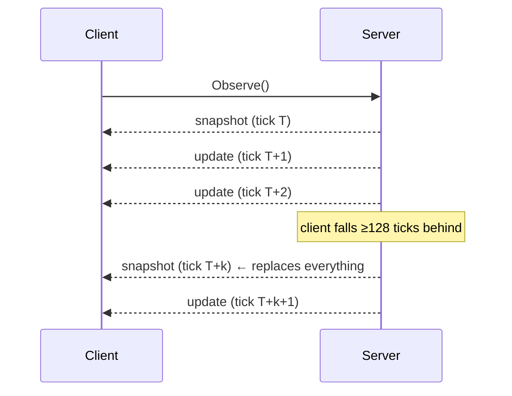

# Streaming and client state

How to keep an exact local copy of your view from `Observe`
(`ObserveWorld` for admins works the same way).

## The protocol



Guarantees, tested in `internal/server`:

- Updates arrive in tick order, one per tick, with no gaps between
  snapshots.
- **snapshot(N−1) + update(N) = snapshot(N)**, including attributes,
  removals and fog tiles.
- A snapshot can arrive **at any time** (after lag, or after a reset), and
  it replaces all entity state.
- **Match resets.** A snapshot whose `match.match_id` differs from the one
  you hold means the world was replaced. Drop everything (entities, memory
  of foreign units, explored tiles) and adopt `match.your_player_id`:
  player IDs are per match.

## Applying messages

```go
entities := map[uint64]*rtsv1.Entity{}
visible := map[[2]int32]bool{}          // fog of war only

on snapshot s:
    entities = index(s.Entities)        // replace everything
    visible = expand(s.VisibleTiles)    // TileRun{y, x, length}
on update u:
    for e in u.Changed: entities[e.Id] = e      // full replacement, never merge attributes
    for id in u.Removed: delete(entities, id)
    for p in u.TilesEntered: visible[p] = true
    for p in u.TilesExited:  delete(visible, p)
    handle u.Events, u.CommandResults           // not part of state
```

Rules of thumb:

- **Replace, don't merge.** A changed entity carries all attributes you
  may see. A missing key means "absent now" (for example, an order that
  ended).
- **Events aren't state.** After a reconnect you get a snapshot and no
  missed events. Derive anything durable from attributes.
- **Command results** appear in the update for the tick the command
  executed (its `scheduled_tick`), only on your streams.

## Fog of war

When `snapshot.fog_of_war` is true:

- **Ownership and identification.** Your entities have
  `identification = OWN`. Foreign ones are `BASIC`, `ESTIMATED` or
  `DETAILED` and carry only the attributes the server's disclosure rules
  allow at that level, possibly as `range_value` estimates.
- **`removed` doesn't say why.** An entity leaving your detection and one
  being destroyed look identical. Keep your own "last known" memory if you
  want it: the web client draws stale ghosts with the tick last seen.
- **Explored tiles are client-side.** The server sends only current
  visibility deltas, so if you want to remember where you've been, track
  it yourself.

## Reconnection

- **Stream broke** (network, server restart): call `Observe` again. It
  starts with a snapshot, so rebuild state from it.
- **`Unauthenticated` on reconnect** means the server restarted and lost
  sessions: `Connect` again with the join token. A restarted server is a
  **new world**, since nothing persists.
- **Unacknowledged commands.** If `SubmitCommand` failed in transit,
  resubmit **with the same `command_id`**. Idempotency guarantees it runs
  at most once.

The Go bot's `play` loop ([`examples/bot/main.go`](../../examples/bot/main.go))
implements exactly this.

## HTTP gateway

`rts-gateway` maps the services to HTTP with canonical **protojson**
(field names in lowerCamelCase, 64-bit integers as strings, enums as
names, unpopulated fields included). Streams are **NDJSON**: one JSON
object per line, `{"snapshot": {...}}` or `{"update": {...}}`.

| Player gateway (`-addr`, :8080) | | Admin gateway (`-admin-addr`, :8081) | |
|---|---|---|---|
| `POST /api/connect` | ConnectRequest → ConnectResponse | `GET /api/snapshot` | GetWorldSnapshotResponse |
| `POST /api/command` | SubmitCommandRequest → SubmitCommandResponse | `GET /api/status` | GetStatusResponse |
| `GET /api/snapshot` | GetSnapshotResponse | `GET /api/observe` | ObserveWorldResponse stream |
| `GET /api/observe` | ObserveResponse stream | `POST /api/spawn` `/api/delete` `/api/move` | SpawnUnit, DeleteEntity, MoveEntity |
| `GET /api/match` | GetMatchResponse | `GET /api/match` | GetMatchDetailsResponse |
| | | `POST /api/reset` `/api/replay/export` `/api/replay/verify` | ResetMatch, ExportReplay, VerifyReplay |
| | | `POST /api/command` | SubmitAdminCommandRequest → response |
| | | `POST /api/pause` `/api/step` `/api/playerview` | SetPaused, Step, GetPlayerView |

Request details:

- **Credentials:** the `Authorization: Bearer <token>` header, forwarded
  as gRPC metadata.
- **Body limit:** 1 MiB.
- **Errors:** JSON `{"code": "<gRPC code name>", "error": "<message>"}`,
  with HTTP 401 (Unauthenticated), 403 (PermissionDenied), 400
  (InvalidArgument, including request JSON the gateway can't parse), 409
  (FailedPrecondition), 503 (Unavailable), otherwise 502.
- **`Any` payloads** in JSON use `"@type": "type.googleapis.com/<full
  name>"` plus the message's fields. The gateway can translate only types
  registered in `internal/protoreg`.

Example stream lines (truncated):

```
{"snapshot":{"tick":"211","entities":[{"id":"1339186860489481623","kind":"ENTITY_KIND_TERRAIN","ownerId":0,"position":{"x":22,"y":10},"attributes":{},"passable":true,"identification":"IDENTIFICATION_LEVEL_BASIC"}, ...
{"update":{"tick":"212","changed":[{"id":"15007611829730354648","kind":"ENTITY_KIND_UNIT","ownerId":423068533,"position":{"x":26,"y":15},"attributes":{"attributes.armor":{"intValue":"0"}, ...
```
