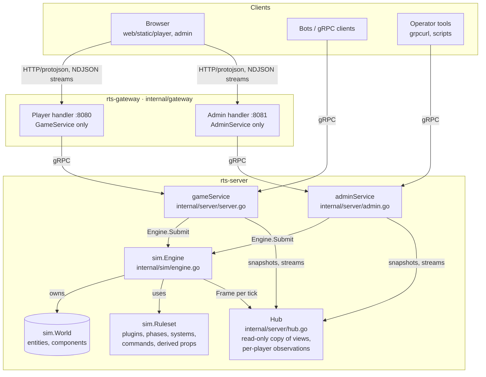
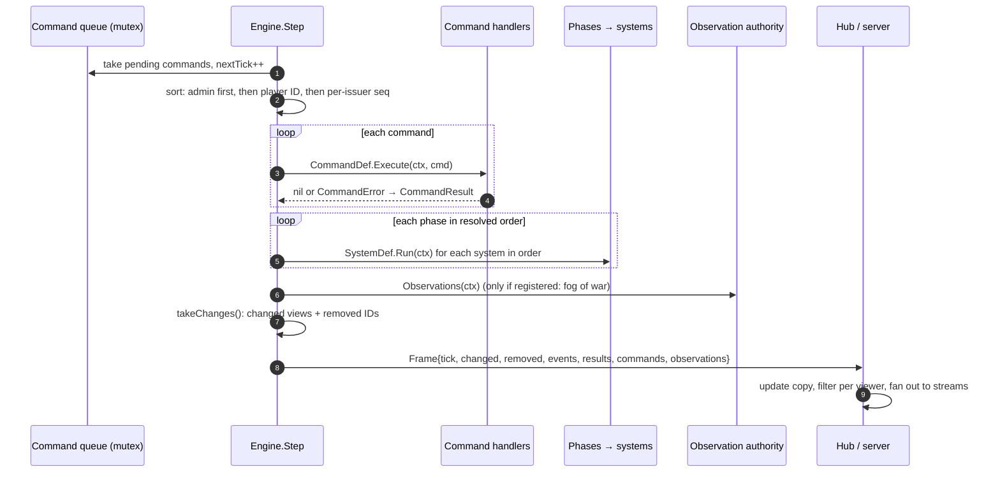
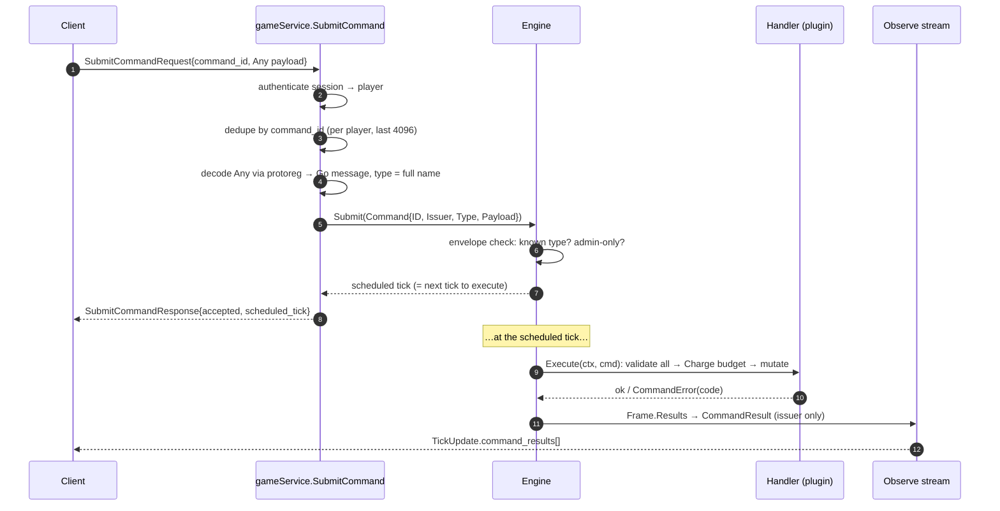
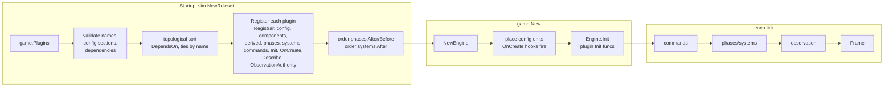

# Architecture

Mono is one Go module (`github.com/dakotaknutson/unit-strategy-game`) that
builds a few binaries. The core idea: a **deterministic simulation kernel**
that knows nothing about game rules or networking, **plugins** that
implement every mechanic, and a **server** that turns the kernel's output
into per-player views.

## System overview



## Packages

| Package | Responsibility | Imports |
|---|---|---|
| [`internal/sim`](../../internal/sim) | The kernel: `World` (entities, occupancy, components, change tracking), `Engine` (tick loop, command queue and ordering, budget), `Ruleset` (plugin registry, phase and system ordering), events, frames, `StateHash`, seeded `Rand`, opaque IDs. **No game rules, no protobuf, no networking.** | stdlib |
| [`internal/expr`](../../internal/expr) | Deterministic integer formula language. | stdlib |
| [`internal/fairshare`](../../internal/fairshare) | Max-min fair integer split, used by mining, salvage and logistics. | stdlib |
| [`internal/plugins/*`](../../internal/plugins) | One package per mechanic: `terrain`, `wells`, `attributes`, `energy`, `upgrades`, `cloning`, `movement`, `metadata`, `combat`, `salvage`, `automation`, `logistics`, `visibility`. | `sim`, each other (declared with `DependsOn`), their own `gen/` packages |
| [`internal/game`](../../internal/game) | Config loading and validation, plugin composition (`game.Plugins()`), building the engine, deriving player IDs, placing initial units. The **only** package that knows which plugins exist. | `sim`, plugins |
| [`internal/protoreg`](../../internal/protoreg) | Imports every plugin's generated proto package so `Any` payloads can be decoded by name. | `gen` |
| [`internal/server`](../../internal/server) | gRPC `GameService` and `AdminService`, sessions, command dedupe, the `Hub`, per-viewer filtering. | `sim`, `game`, `gen`, `protoreg` |
| [`internal/gateway`](../../internal/gateway) | HTTP/NDJSON ↔ gRPC bridge for browsers. Just another API client. | `gen`, `protoreg` |
| [`internal/plugintest`](../../internal/plugintest) | Test harness over the real plugin composition. | `game`, plugins |
| [`internal/scale`](../../internal/scale) | Repeatable large-world scenarios and measurement. | `game`, plugins |
| [`proto/`](../../proto) → [`gen/`](../../gen) | Public API (`rts.v1`) and one package per plugin for its command messages. Generated code is committed. | — |
| [`web/static`](../../web/static) | Player and admin clients (plain JS, no build step) and shared rendering code. | gateway HTTP API |
| [`examples/`](../../examples) | Example plugin (`examples/plugins/regeneration`) and bot (`examples/bot`). Not part of the server build. | — |

Dependency direction: `sim` ← plugins ← `game` ← `server` ← binaries.
Plugins never import `server`; the kernel never imports anything
game-specific.

## Ownership of authoritative state

- **All authoritative state lives in one `sim.World`**: entities
  (`ID`, `Kind`, `Owner`, `Pos`, `Passable`) and typed component values.
  There are no package-level mutable game variables.
- **Only the simulation goroutine touches the `World`**: the one calling
  `Engine.Run` or `Engine.Step`. Setup code may touch it before the engine
  starts.
- **Everything else reads frames.** The server never reads the `World`
  while the engine runs; it reads the `Hub`, which is built purely from
  frames.
- **Plugins mutate state only** inside command handlers, systems, `Init`
  and `OnCreate` hooks, all of which run on the simulation goroutine.

## Tick lifecycle



With every built-in plugin the resolved order is (`Ruleset.Schedule()`):

```
automation: automation.evaluate
energy:     energy.mine, energy.transfer
logistics:  logistics.supply
salvage:    salvage.collect
movement:   movement.step
combat:     combat.resolve
upgrades:   upgrades.progress
cloning:    cloning.progress
(then the visibility plugin's Observations)
```

Details in [simulation.md](simulation.md).

## Command lifecycle



**Acceptance is not execution.** The acknowledgment only says the
envelope was valid and names the tick. World-state validation (ownership,
range, energy) happens at execution and is reported in the
`CommandResult`. See [commands.md](commands.md).

## Plugin execution pipeline



See the [plugin guide](plugins/overview.md).

## Client synchronization

Each viewer receives a **snapshot**, then **one `TickUpdate` per tick**.
Updates contain full replacement entities for everything that changed,
removed IDs, events and command results, all filtered for that viewer.
Applying update *N* to snapshot *N−1* gives snapshot *N*, and the server
tests check exactly that. A stream that lags 128 frames gets a fresh
snapshot instead. See [events.md](events.md) and
[api/streaming.md](../api/streaming.md).

## Design decisions

The reasoning behind the main choices (proto-free kernel, typed generic
components, all-fail tile contention, full-entity updates, admin
mutations as scheduled commands, cumulative cost formulas, total integer
formula semantics, ...) is collected in
[design-notes.md](design-notes.md#key-decisions-and-tradeoffs).
