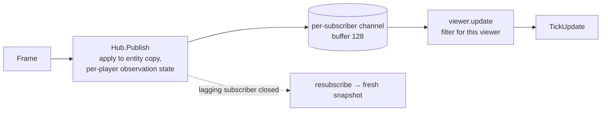

# Events, frames and client synchronization

## Events

Plugins report things that happened with `ctx.Emit(sim.Event{...})`:

```go
type Event struct {
    Type     string       // "<plugin>.<name>", e.g. "movement.arrived"
    Entity   sim.EntityID // primary entity, or 0
    Audience sim.Audience // who receives it
    Fields   []sim.Field  // payload: key → sim.Value
}
```

| Audience | Constructor | Delivered to |
|---|---|---|
| One player | `sim.ToPlayer(p)` | That player and admins |
| Everyone | `sim.ToAll()` | Every player and admins, **even under fog of war** |
| Admins only | `sim.AdminAudience()` (zero `Audience`) | Admins only |

Events are a **notification** channel, not state. Anything a client needs
to reconstruct the world must be in entity attributes, because clients
that reconnect get a snapshot and no past events. Events carry the
moment-to-moment detail: amounts mined, damage dealt, why an order ended.

The full list of built-in events is in the
[event reference](../reference/events.md).

### Routing rules (`internal/server/view.go`)

In `viewer.update`:

- An event goes to a player if `Audience.All` is set or
  `Audience.Player` is that player. Admins receive every event.
- A command result goes only to its issuer. Admin results go to admin
  streams, and all admin sessions share one admin identity.
- **Under fog of war, `ToAll` bypasses detection.** Use it only for
  information every player is allowed to have. Built-in plugins address
  almost everything to specific players; even well depletion goes only to
  the players whose units drained the well.

## Frames

Each tick produces one immutable `sim.Frame`:

| Field | Content |
|---|---|
| `Tick` | The executed tick. |
| `Changed` | Full views of entities created or modified this tick, sorted by ID, with all attributes tagged by visibility. |
| `Removed` | IDs removed this tick, sorted. |
| `Events` | All events, in emission order. |
| `Results` | One `CommandResult` per executed command. |
| `Commands` | The executed commands, in execution order (the replay log). |
| `Observations` | Per-player observation deltas, when an observation authority (fog of war) is registered. |
| `ObservationMode` | Whether one is registered. |

## From frames to clients



**Without fog of war:**

- Every changed and removed entity is sent to every player.
- Attributes are filtered by visibility: owner-only attributes go only to
  the owner, and admin-only attributes never go to players.

**With fog of war** (the visibility plugin is the observation authority):

- A player's own entities are sent in full.
- Foreign entities come only from that player's `Observation` upserts,
  which the authority has already filtered to the disclosed level.
- `Removed` includes only the player's own removals and the entities they
  *lost* (loss and destruction look the same).
- Tile visibility deltas come as `tiles_entered` and `tiles_exited`.

**Snapshots** (`GetSnapshot`, and the first `Observe` message) are built
from the Hub's copy with the same filter. The invariant, tested in
`internal/server`, is:

> snapshot(N−1) + update(N) == snapshot(N)

so a client that applies every update stays exact, and one that misses
any re-synchronizes from a snapshot. See
[api/streaming.md](../api/streaming.md) for the client side.

## Rules descriptions

`Registrar.Describe(v)` publishes a plugin's effective configuration as
JSON, in `WorldInfo.rules_json[<plugin>]` (returned by `Connect` and
`GetWorldSnapshot`). It's public: never put secrets in it. Clients use it
for cost tables, ranges and formulas.
