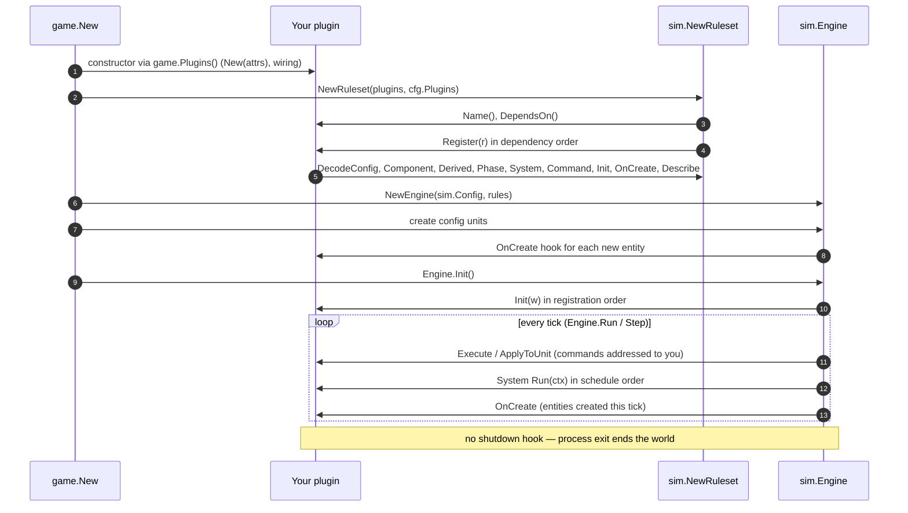

# Plugin lifecycle



| Stage | Your code | Notes |
|---|---|---|
| **Construction** | `New(...)` called from `game.Plugins()` | Store dependencies (e.g. `*attributes.Plugin`). No world access yet. |
| **Registration** | `Register(r)` | Called **once**. Decode and validate config; declare everything. Return an error to abort startup. |
| **Engine creation** | — | The world is empty and sized. |
| **Initial units** | `OnCreate` hooks | `game.New` creates the config's units, and every `OnCreate` hook runs for each (energy stores, attribute records, combat health). |
| **Init** | `Init(w)` functions | After units, before tick 1, in registration order. Place your own initial entities here (wells, terrain). Errors abort startup. |
| **Ticks** | Command handlers, systems | On the simulation goroutine. Commands first, then phases in schedule order. Entities created during the tick also trigger `OnCreate`. |
| **Observation** | `ObservationAuthority.Observations(ctx)` | Only the visibility plugin; after every system. |
| **Pause and step** | — | Nothing special: paused means no ticks. |
| **Shutdown** | — | **No hook.** `rts-server` stops the engine and gRPC on SIGINT/SIGTERM; all state is in memory and is discarded. |

## Entity-level lifecycle

There's no "removed" callback. When an entity is removed (destroyed,
depleted, deleted by an admin), the kernel drops all of its components,
yours included. Code that stores references to other entities must
validate them before use and end the dependent order with an event:

```go
target, ok := w.Entity(o.Target)
if !ok { // removed since last tick
    orders.Remove(w, id)
    ctx.Emit(sim.Event{Type: "myplugin.ended", Entity: id, Audience: sim.ToPlayer(owner),
        Fields: []sim.Field{{Key: "reason", Value: sim.StringValue("target_lost")}}})
}
```

Combat offers `(*combat.Plugin).OnDestroyed(fn)` for reacting to combat
destruction specifically; salvage uses it to create wrecks.

## Plugin struct state

A plugin value lives as long as the process, but it should hold only:

- **configuration** (decoded in `Register`)
- **references** to other plugins
- **reusable scratch buffers** whose contents never outlive one tick

Anything that affects future ticks belongs in components, so it is part
of `StateHash`, survives replay, and shows up in views. See
[state-and-determinism.md](state-and-determinism.md).
