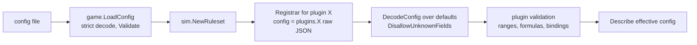

# Plugin registration reference

## Where plugins are registered

There is exactly one registry: the slice returned by
**`game.Plugins()`** in [`internal/game/game.go`](../../../internal/game/game.go).

```go
func Plugins() []sim.Plugin {
    attrs := attributes.New()
    vis := visibility.New(attrs)
    fighting := combat.New(attrs)
    energyP := energy.NewWithAttributes(attrs)
    salvageP := salvage.New(attrs, fighting)
    // Fog of war gates every command that refers to a foreign entity.
    fighting.CanTarget = vis.Detected
    energyP.CanSee = vis.Detected
    salvageP.CanSee = vis.Detected
    auto := automation.New(fighting)
    auto.Detected = vis.Detected
    return []sim.Plugin{
        terrain.New(), wells.New(), attrs, energyP, upgrades.New(attrs), cloning.New(attrs),
        movement.NewWithAttributes(attrs), metadata.New(), fighting, salvageP, auto,
        logistics.New(attrs), vis,
    }
}
```

What this shows:

- **Construction is explicit composition.** Plugins that need another
  plugin's instance get it through their constructor (the shared
  `*attributes.Plugin`, combat for salvage and automation).
- **Cross-plugin hooks are wired here**, not discovered. Fog of war gates
  targeting, mining and salvage by assigning `vis.Detected` to function
  fields such as `CanTarget`, `CanSee` and `Detected`.
- **`game.New`** calls `Plugins()` once per world and passes the result to
  `sim.NewRuleset(plugins, cfg.Plugins)`.

### Built-in vs. third-party plugins

They're registered the same way: add the constructor call to
`game.Plugins()` and import the package. "Third-party" here means a
plugin package that lives in this repository or a fork:

- the plugin API is under `internal/`, so Go only allows packages inside
  this module to import it
- there is **no runtime loading** (`plugin.Open`), no plugin directory, no
  registration by `init()` side effects and no config switch that adds
  plugins

A plugin with commands also needs its proto file listed in
[`internal/protoreg`](../../../internal/protoreg/protoreg.go), so the
server and gateway can decode its `Any` payloads.
`TestEveryCommandTypeIsRegisteredForGateways` enforces it.

The [tutorial](getting-started.md#12-register-the-plugin-with-the-server)
has the complete, verified diff for the example plugin.

### Tests and tools can compose differently

`sim.NewRuleset` takes any `[]sim.Plugin`, so tests can build minimal or
extended compositions without touching `game.Plugins()`:

```go
attrs := attributes.New()
rules, err := sim.NewRuleset([]sim.Plugin{
    wells.New(), attrs, energy.NewWithAttributes(attrs), movement.NewWithAttributes(attrs),
    regeneration.New(attrs),
}, map[string]json.RawMessage{"regeneration": json.RawMessage(`{"enabled": true}`)})
```

`game.New` (and therefore `rts-server`) always uses `game.Plugins()`.

## What `sim.NewRuleset` does

In order ([`internal/sim/plugin.go`](../../../internal/sim/plugin.go)):

1. **Names.** Each `Name()` must be non-empty, contain no `.` or space,
   not be `sim`, and be unique.
2. **Config sections.** Every key in the config's `plugins` object must
   name a plugin in the list.
3. **Dependencies.** Every `DependsOn` entry must exist. The plugins are
   topologically sorted, breaking ties **by name**, and cycles are
   rejected. That order is the **registration order**: it's printed at
   startup, published as `WorldInfo.plugins`, and is the order of `Init`
   and `OnCreate` hooks. The order of the slice in `game.Plugins()`
   doesn't matter.
4. **Kernel commands.** `sim.CreateEntity`, `sim.RemoveEntity` and
   `sim.MoveEntity` are pre-registered.
5. **`Register`.** Each plugin's `Register` is called with a `Registrar`
   bound to its name and config section. Each declaration is validated
   immediately: prefixes, uniqueness, required functions.
6. **Phases.** Phases are topologically ordered by `After` and `Before`.
   Unknown phase names and cycles are rejected.
7. **Systems.** Systems are ordered within each phase by `After`. Unknown
   phases or systems, cross-phase `After` and cycles are rejected.

The result is an immutable `*sim.Ruleset`: `Plugins()`, `Schedule()`,
`CommandTypes(includeAdmin)`, `Rules()`, `HasObservationAuthority()`.

## Duplicates and conflicts

| Situation | Result |
|---|---|
| Two plugins with the same name | `plugin "x" registered twice` |
| Two components, systems or derived properties with the same name | `... already declared` (names are prefixed, so this only happens within one plugin) |
| Two plugins declare the same **phase** name | `phase "x" already declared`. Phase names are global, so prefer the plugin name. |
| Two plugins register the same **command type** | `command "x" already declared` |
| A second observation authority | `an observation authority is already registered` |
| A name without the `<plugin>.` prefix | `... must be prefixed with "<plugin>."` |

## Enabling and disabling

- The engine has no per-world plugin toggle. **Every plugin in
  `game.Plugins()` is registered in every world**, with or without a
  config section.
- To remove a plugin, delete it from `game.Plugins()`, along with
  plugins that depend on it and any wiring that references it, then
  rebuild.
- Plugins can make themselves inert by configuration. The built-in
  convention is an `enabled` flag that defaults to `false` (`visibility`,
  and the example plugin), or empty lists (`wells.wells`,
  `terrain.tiles`).

## Configuration loading



A plugin receives **only its own section**, as raw JSON. Pre-fill the
struct with defaults before `DecodeConfig`, so omitted fields keep them.

## Startup validation and failure

Registration errors, config errors and `Init` errors all abort startup:

- `game.New` returns the error.
- `rts-server` calls `log.Fatal`, before any listener opens.

Error messages name the plugin and the offending field, for example:

```
register plugin "regeneration": regeneration: interval must be in 1..1000, got 0
plugin "regeneration" config: json: unknown field "amout"
plugin "regeneration" depends on missing plugin "energy"
init plugin "wells": ...
```

A world never starts in a partially registered state.

## Failures at runtime

- **Command errors** become `CommandResult`s and don't affect the server.
- **There is no recovery around systems.** A panic in a system or handler
  crashes the process: Go's default behavior, and the kernel doesn't
  `recover`.
- **Handle every unexpected case** in your plugin, for example a target
  that vanished, by ending the order with an event rather than panicking.
