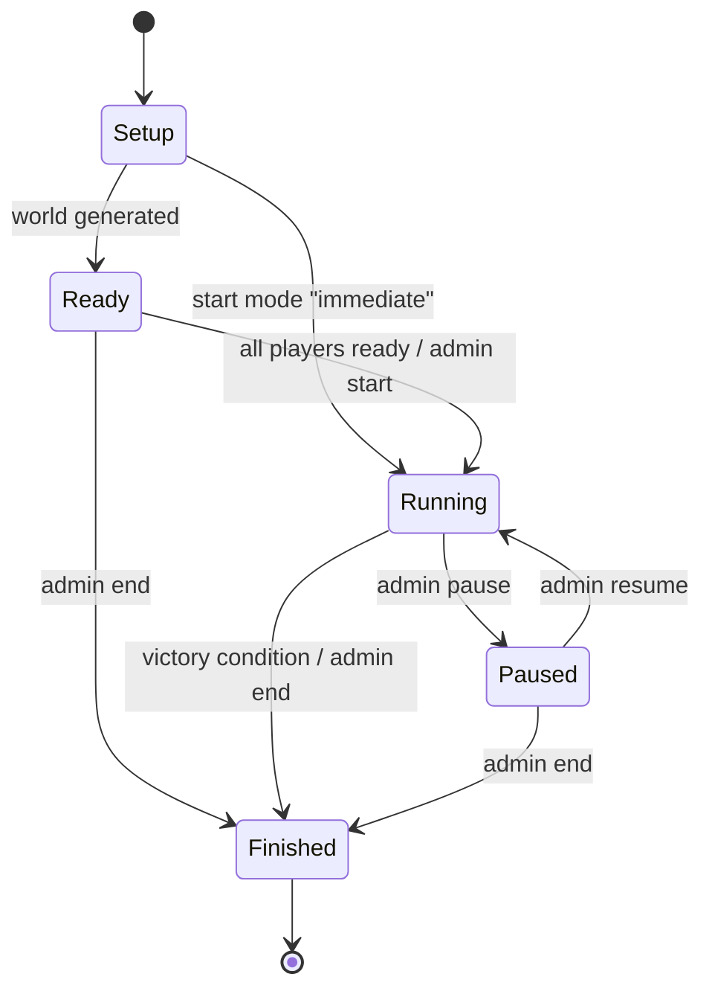

# Matches: lobby, victory, scoring and results

A server hosts one **match** at a time. A match has a lifecycle, objectives
(victory conditions) and, at the end, a public result. When it's over, an
administrator can **reset** the server into a new match. You stay
connected and join it automatically.

## Lifecycle



| State | What you can do |
|---|---|
| **Setup** | Nothing yet: the world is being built (brief). |
| **Ready** | Look at the map and your starting units, and mark yourself **Ready**. Gameplay commands are rejected (`failed_precondition`, "match is ready"). |
| **Running** | Play. The match clock runs. |
| **Paused** | An administrator suspended the match. Units freeze, the clock stops, and commands are rejected until it resumes. |
| **Finished** | The result is public. Nothing changes until an administrator starts a new match. |

How a match starts depends on the server's `match.start` setting:

| Mode | Starts |
|---|---|
| `immediate` | Right away (sandbox play; the default). |
| `all_ready` | When every player (or `min_players` of them) has pressed **Ready**. |
| `manual` | When an administrator starts it. |

The web client shows the state in the header and the details in the
**Match** panel: objectives, map, readiness, clock, your score.

## Victory conditions

Checked at the end of every running tick, in this order:

1. **Last player standing** (`elimination`). A player with no units left
   is **eliminated**: announced to everyone, and their commands are refused
   from then on. When only one player remains, they win. If the last
   players are eliminated in the same tick, it's a **draw**. This needs at
   least two players to ever trigger.
2. **Custom conditions** a server may add, such as the example "king of
   the hill".
3. **Time limit**: after `time_limit_ticks` ticks of running time, the
   highest score wins. Equal top scores are a draw.

An administrator can also end a match at any time, with or without a
winner, or eliminate a player.

## Score

Score measures how well you're doing. It is **never spendable**:

```
score = Σ weight × metric
```

| Metric | Kind | Meaning |
|---|---|---|
| `units` | current | Your living units |
| `embodied` | current | Upgrade investment carried by your living units |
| `stored_energy` | current | Energy in your units |
| `energy_mined` | cumulative | Energy your units extracted this match |
| `kills` | cumulative | Enemy units destroyed while your units were hitting them |
| `investment_destroyed` | cumulative | Invested energy of enemy units you destroyed |
| `units_lost` | cumulative | Your units destroyed (usually a negative weight, if used) |

The server's configuration sets the weights; they're published in the
rules (`rules_json.match`). Scores are recomputed every
`scoring.interval_ticks` ticks and at the end. During a match you see your
own score; you see everyone's only if the server makes scores public
(`scoring.public_during_match`). After the match, all scores are public.

## Results

When a match finishes, everyone gets the result:

- match ID, the world **seed** (secret until now, because it would reveal
  the map), the ruleset fingerprint
- winner, or a draw, and the reason
- the final tick and running time
- per player: score, units, embodied investment, stored energy, energy
  mined, kills, units lost, investment destroyed

The web client opens a results table automatically. Bots get the result in
`MatchInfo.result` and `GetMatch`. Recent results stay available
(`GetMatch.history`).

## Disconnecting and reconnecting

- **Disconnecting doesn't eliminate you or pause anything.** Your units
  keep their orders, automation and supply links running.
- **Reconnect** with the same join token: you're the same player, with no
  duplicate identity.
- **Joining late** is allowed. Your units were placed when the match was
  generated, and you take control whenever you connect.

## New matches (resets)

- **What a reset does.** It discards the world and builds a new one, with
  new IDs and possibly a new map and seed. Your session survives: the
  client receives a fresh snapshot with a new `match_id` and starts over.
- **Your player ID changes per match.** Clients must use
  `MatchInfo.your_player_id`; the web client and the example bots do.
- **Fog-of-war memory** (explored tiles, ghosts) is cleared on a reset.
